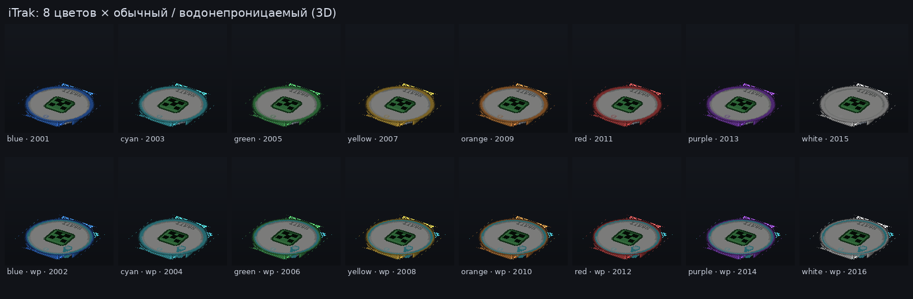
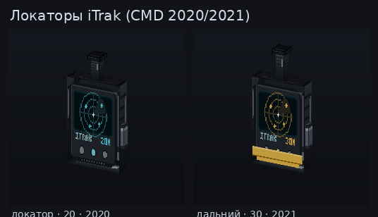
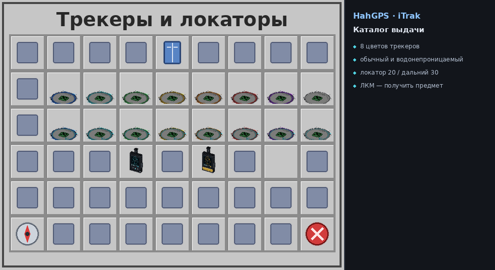
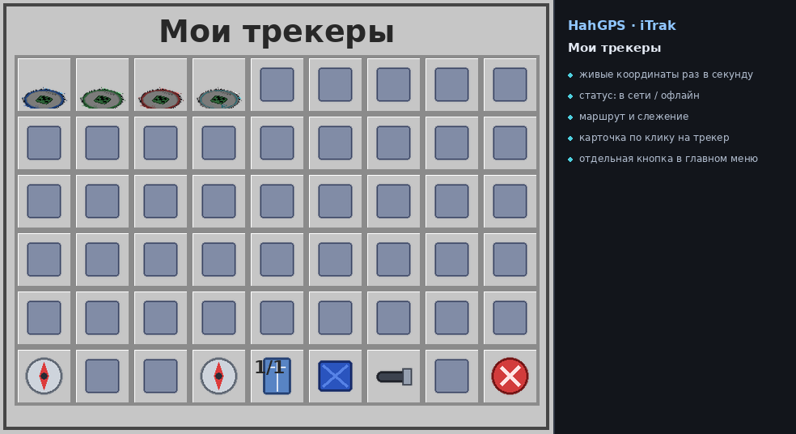
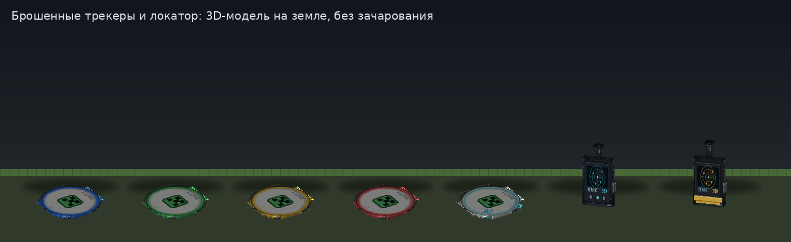

# HahGps — GPS-навигация для PaperMC

Плагин GPS-навигации для Minecraft-сервера **NewJersey** на Paper 1.21.x (Java 21).
Меню оформлены **в стиле основного плагина hahtojer** (RGB-палитра, градиентные
заголовки, единая сетка навигации), чтобы игрок не замечал разницы между плагинами.

## Возможности

- **Точки (POI)**: создание, удаление, оценка (1–10), категории, список, нечёткий поиск
  с учётом популярности: чем чаще игроки находили этим текстом одно и то же место,
  тем выше оно в выдаче (надбавка ограничена, чтобы не обгонять явно лучшее
  совпадение). Сколько мест показывать — 1–25, настраивается в меню поиска
  или ключом `/gps search -n 3`; при наведении на место видны полное название,
  координаты, число искавших игроков и процент совпадения. В чате `/gps search`
  строка — только название: все показания (координаты, число искавших, процент)
  живут в подсказке при наведении, а под строкой висит кнопка «построить маршрут».
- **Маршруты** по графу дорог (A\* с ограничением расширений): граф собирается из
  записанных маршрутов (`/gps route record`), узлы связываются рёбрами FOOT и CAR.
  Пешеходу граф не навязывается: если записанная дорога ведёт крюком (длиннее
  прямой в `navigation.walk-detour-factor` раз и хотя бы на
  `navigation.walk-detour-blocks` блоков), плагин строит путь по блокам и берёт
  более короткий. Если путь не найден — маршрут вырождается в прямую линию,
  а причина уходит в лог.
- **Навигация**: BossBar со стрелкой направления и расстоянием, подсказки в чате
  (ActionBar намеренно пуст — указатель не дублируется), авто-обновление боссбара
  при уходе с линии маршрута. Восемь направлений (прямо/чуть/поворот/резко/разворот)
  и нарисованные жёлто-чёрные стрелки из ресурспака `respack/dist/hahgps.zip`:
  один и тот же глиф 10×10 с тёмным контуром рисуется и в BossBar, и в
  подсказках чата (`↑ Идите прямо`, `← Поверните налево`).
- **Меню трекеров**: в главном меню две отдельные кнопки — «Трекеры и локаторы»
  (каталог выдачи: 8 цветов трекеров, обычные и водонепроницаемые, оба локатора;
  ЛКМ выдаёт предмет) и «Мои трекеры» (список установленных маячков
  с живыми координатами, статусом, маршрутом и карточкой). Карты в плагине нет:
  вместо неё — меню и каталог.
- **iTrak — GPS-трекеры**: предмет-трекер цепляется на любую поверхность (в том числе
  на воду: водонепроницаемый держится и **плывёт по течению**, обычный тонет), его
  можно **бросить** и снять, а трекер и локатор **крафтятся** в верстаке. Водонепроницаемый Shift-броском или Shift-кликом по дну топят
  намеренно — он лежит на дне и продолжает передавать сигнал.
  Трекер, прицепленный к игроку, показывает при наведении на строку ник носителя
  и его статус — в сети или офлайн. Каждый трекер получает уникальный порядковый код из БД — коды не повторяются
  никогда, поэтому второй предмет с тем же кодом больше не «залипает» на уже
  установленном трекере. 8 цветов и водозащита, привязка к **любому существу**
  (лодка, вагонетка, лошадь, свинья, стойка для брони, рамка — всё, что двигается
  и стоит) с живыми координатами: трекер сам получает русское имя («Лодка»,
  «Свинья») и цвет по типу носителя (лодка — синий, лошадь — жёлтый, свинья —
  зелёный, монстр — красный, техника — голубой), поэтому маячок сразу узнаётся
  в списке. **С игрока трекер не слетает** — при выходе он показывает «офлайн»
  на последних координатах и снова цепляется при входе, пока его не снимут
  (с мобов и транспорта при смерти слетает предметом, как раньше), локаторы
  на 20 и 30 блоков с подсветкой найденного, меню слежения с обновлением
  координат раз в секунду, статус «неподвижен N» с подсказкой маршрута, живой
  маршрут к движущемуся трекеру. Локатор даёт 5 удачных сканирований (`itrak.scan-attempts`),
  пустой скан попытку не тратит и в перезарядку не уводит, а после попыток —
  5 минут КД (дальний — 7); на время КД на предмете видна белая ванильная полоса,
  но только на локаторе — у трекеров свои материалы, КД маячков не касается.
  Дальше 100 км (`itrak.signal-range`) точные координаты не показываются: в карточке
  видно район и последнее место, которое успело дойти до игрока, а маршрут ведёт
  в район, а не в точку. Если локатор нашёл
  маячок на самом сканирующем, под строкой — кнопка «снять трекер», а не
  «построить маршрут». Маркер над трекером видит только тот, кто его поставил
  (`itrak.particles-owner-only`), а найти чужой трекер можно локатором.
  **`/gps itrak find [код|имя|id]`** — личный локатор как «Локатор» в телефоне:
  без аргумента открывает «Мои трекеры», с аргументом — карточку выбранного
  трекера. Подробности — [docs/itrak.md](docs/itrak.md).
- **Маршрут обходит стены**: если граф дорог не даёт путь, A* строит пеший
  маршрут по блокам — прыгает на уступ, обходит лаву и стены, а не ведёт по
  прямой сквозь горы (`navigation.walk-fallback`).
- **Меню в стиле hahtojer**: `GuiTheme` (RGB-палитра из 28 цветов + фирменный
  градиент `#2464c8 → #8fe9f5`), градиентные заголовки, панели фона,
  навигация 45/49/52/53, бренд-предмет, звуки клика/страницы/отказа.
- **Автообновление из GitHub Releases** с горячей подменой без перезапуска сервера
  (см. ниже) и **проверкой скачанного jar токеном сборки**; сборка без токена
  не обновляет себя вовсе.

## Скриншоты












## Сборка

```bash
python3 respack/build.py  # pillow + numpy; кладёт hahgps.zip в jar
./mvnw clean package      # Windows: mvnw.cmd clean package
```

Maven-обёртка лежит в репозитории (`mvnw`, `mvnw.cmd`, `.mvn/wrapper`), поэтому отдельно
устанавливать Maven не нужно. Нужен только JDK: переменная `JAVA_HOME` должна указывать
на JDK 17 или новее.

Готовый jar: `target/hahgps-<версия>.jar` (с встроенными SQLite и MySQL драйверами).

**Java.** Плагин собирается с `--release 17`, то есть байт-код в jar — major 61, и один
и тот же файл запускается на любой серверной JVM новее 17 (Java 17, 21, 25 и далее).
Собирать можно любой JDK ≥ 17 — важна опция `release`, а не версия локальной Java.
Требование Java 21 у Paper 1.21.x относится к серверу, а не к нашему jar.

Сборка гоняет 219 юнит-тестов. Логика — `PathfinderTest` (поиск пути, транспортные
фильтры, мультимодальность, fallback в прямую линию), `SqliteStorageProviderTest`
(реальное хранилище: точки, оценки, каскадное удаление, маршруты, игнорирование
незагруженных миров), `FuzzyMatcherTest`, `UpdaterServiceTest` (версии и защита от
выхода файла токена за папку плагина), `EntityNamesTest` (у каждого типа сущности
есть русское имя и цвет по носителю), `SignalRegionTest` (район вместо точной
точки за дальностью сигнала), `LocatorCooldownTest` / `LocatorMaterialTest`
(перезарядка и то, что материалы трекеров не совпадают с локатором). Оформление —
`GuiThemeTextTest`, `MessagesPaletteTest`, `MessageKeysExistTest` (RU/EN-паритет ключей).

## Установка

1. Скопировать `hahgps-<версия>.jar` в папку `plugins/`.
2. Запустить сервер — плагин создаст `config.yml`, `messages_ru.yml`, `messages_en.yml`
   и базу `hahgps.db`.
3. Настроить `config.yml` под нужды (в том числе секцию `обновление`).
4. Перезагрузить через `/gps reload`.
5. По желанию — поставить ресурспак стрелок: в игре выполнить `/gps pack`
   (плагин раздаст встроенный `hahgps.zip`) и подтвердить установку. Вручную —
   скачать `hahgps.zip` из релиза, положить в `.minecraft/resourcepacks/`
   и включить. Подробности — в `respack/README.md`.

### Главное правило: в `plugins/` лежит ровно один HahGps

Paper идентифицирует плагин по паре **имя + версия из `plugin.yml` внутри jar**. Если
в `plugins/` два файла с этой парой (например, старый `HahGPS.jar` и новый
`hahgps-1.0.7.jar`), второй не грузится:

```
[ERROR]: [ModernPluginLoadingStrategy] Could not load plugin 'hahgps-1.0.7.jar' ...
java.lang.IllegalStateException: Provider ... attempted to add duplicate plugin identifier ...
```

Это не ошибка Java и не проблема версии сервера: плагин из старого файла при этом
работает, а новый молча не включается (в `plugins` в списке видно оба).

При ручной замене jar (файл-менеджер, панель Pterodactyl, SCP):

```bash
# 1. остановить сервер
# 2. посмотреть, что лежит в папке
ls -la plugins/ | grep -i hahgps
# 3. убрать ВСЕ старые копии плагина, оставить один новый файл
rm -f plugins/HahGPS.jar plugins/HahGPS-1.0.0.jar
# 4. удалить кэш ремаппера Paper: старые копии там остаются и путаются с новым jar
rm -rf plugins/.paper-remapped
# 5. залить hahgps-<версия>.jar и запустить сервер
```

Проверить, что внутри залитого файла (имя и версия обязаны совпадать с именем файла):

```bash
unzip -p hahgps-1.0.7.jar plugin.yml | head -3
unzip -p hahgps-1.0.7.jar META-INF/MANIFEST.MF | grep Implementation
```

Ожидается `name: HahGps`, `version: '<версия>'` и `Implementation-Version: <версия>`.
Если в `plugin.yml` старая версия — значит залит не тот файл.

Автообновление (`/gps update`) подменяет jar сам: новый кладётся как
`plugins/hahgps-<версия>.jar`, старый удаляется. После горячей подмены **перезапуск
всё равно нужен один раз** — старый файл мог остаться на диске, если удаление не
прошло (например, файл был занят Windows). Следи, чтобы в `plugins/` не копились
`hahgps-*.jar` разных версий.

## Команды

| Команда | Описание |
|---------|----------|
| `/gps menu` | Главное меню |
| `/gps point create <имя> [категория] [описание]` | Создать точку (категория может быть из нескольких слов) |
| `/gps point delete <имя>` | Удалить точку |
| `/gps point info <имя>` | Информация о точке |
| `/gps point rate <имя> <1-10>` | Оценить точку |
| `/gps point list` | Список точек |
| `/gps category create <имя>` | Создать категорию |
| `/gps category delete <имя>` | Удалить категорию |
| `/gps category list` | Список категорий |
| `/gps goto <имя> [foot\|car]` | Построить маршрут к точке |
| `/gps search [-n 1..25] <запрос>` | Поиск точек (сколько мест — от 1 до 25) |
| `/gps route start <точка> [foot\|car]` | Начать навигацию |
| `/gps route stop` | Остановить навигацию |
| `/gps off` | То же, что `/gps route stop` |
| `/gps route record start` | Начать запись пути (из неё собирается граф дорог) |
| `/gps route record stop` | Остановить запись пути |
| `/gps route save <имя> [транспорт]` | Сохранить записанный путь как маршрут и пересобрать граф |
| `/gps log` | Переключить подсказки в чате |
| `/gps pack` | Скачать и установить ресурспак со стрелками, 3D-трекерами и локаторами (пак не навязывается при входе) |
| `/gps update status` | Состояние автообновления (версия, репозиторий, токен, что готово) |
| `/gps update check` | Проверить релизы GitHub прямо сейчас |
| `/gps update install` | Проверить, скачать и поставить новую версию на ходу |
| `/gps update apply` | Поставить уже скачанный jar без рестарта сервера |
| `/gps update reload` | Перечитать настройки обновления из `config.yml` |
| `/gps reload` | Перезагрузить конфиг (работает и из консоли) |
| `/gps itrak` или `/itrak` | «Мои трекеры»: список установленных трекеров |
| `/gps itrak give <цвет> [waterproof] [имя] [игрок]` | Выдать трекер iTrak |
| `/gps itrak give-locator [радиус\|long] [игрок]` | Выдать локатор iTrak (по умолчанию 20 блоков, `long` — 30) |
| `/gps itrak scan` | Найти трекеры поблизости (то же — ПКМ локатором) |
| `/gps itrak find [код\|имя\|id]` | Открыть «Мои трекеры»; с аргументом — карточку выбранного трекера |
| `/gps itrak list` | Список трекеров |
| `/gps itrak info <код\|имя\|id>` | Карточка трекера |
| `/gps itrak route <код\|имя\|id> [foot\|car]` | Живой маршрут к трекеру |
| `/gps itrak name <код\|id> <новое имя>` | Переименовать трекер; без кода — переименовать трекер в руке, `-` снимает название |
| `/gps itrak open <код\|id\|имя>` | Открыть карточку трекера в меню (на эту команду ведут клики по строкам трекеров в чате) |
| `/gps itrak take <код\|имя\|id>` | Подобрать трекер |
| `/gps itrak remove <код\|имя\|id>` | Удалить трекер (админ) |
| `/gps itrak watch <код\|имя\|id>` / `unwatch` | Слежение за трекером (координаты в чат) |

## Права

- `gps.use` — базовое использование (в том числе сокращение `/gps <точка>`)
- `gps.point.create` — создание точек
- `gps.point.delete` — удаление точек
- `gps.point.rate` — оценка точек
- `gps.category.create` / `gps.category.delete` — управление категориями
- `gps.route.record` / `gps.route.save` — запись и сохранение маршрутов
- `gps.search` — поиск
- `gps.reload` — перезагрузка конфига
- `gps.pack` — скачать ресурспак стрелок через `/gps pack` (по умолчанию всем)
- `gps.itrak` — трекеры iTrak: поставить, сканировать, смотреть, следить, строить маршрут
- `gps.itrak.give` — выдача трекеров и локаторов, по умолчанию для операторов
- `gps.itrak.admin` — видеть и снимать любые трекеры, игнорировать радиус подбора, по умолчанию для операторов
- `gps.admin` — полный доступ (в том числе `/gps update`), по умолчанию для операторов

Какие виды транспорта доступны игрокам, определяется секцией `transport` в `config.yml`,
а не правами: право `gps.transport` убрано, потому что ни на что не влияло.

## Меню и оформление

Стиль совпадает с основным плагином **hahtojer**:

- палитра — **одна синяя линейка из 10 тонов** (`ru.hahgps.gui.GuiTheme.TONES`:
  `#08122b … #8fe9f5`). Зелёных, красных, золотых, оранжевых, фиолетовых и
  розовых оттенков в текстах нет вообще — разделы отличаются не цветом, а тоном
  синего: `#8fe9f5` — ✔ успех, `#8fc6ff` — значения и кнопки, `#66aaff` — →
  подсказки, `#4fd1e0` — «резко вбок», `#3f86ff` — ✖ ошибки;
  нейтрали: `<white>` — значения, `<gray>` — подписи, `<dark_gray>` — разделители.
  Схема файла сообщений — 6: старые файлы сообщений автоматически заменяются эталоном
  (прежняя копия — `.bak`);
- шрифты: обычный текст — стандартный шрифт Minecraft, переключений шрифта нет;
  «разные шрифты» сделаны декорациями — `<bold>` (жирный), `<italic>` (курсив),
  `<underlined>`, `<strikethrough>`;
- другой **размер** (мини-шрифт `<font:minecraft:uniform>`) оставлен только там,
  где это уместно: дата создания точки, версия и дата релиза, версия в
  бренд-предмете. Руны `minecraft:alt` убраны полностью (см. `docs/gui.md`);
- заголовки меню — фирменный градиент тёмно-синий → синий → бирюза (`gradientTitle`)
  жирным, префикс чата — `<gray>[</gray><bold><gradient:#2464c8:#8fe9f5>GPS</gradient></bold><gray>]</gray>`;
- текст не вылезает за границы: заголовок окна ≤ 28 симв., имя предмета ≤ 30,
  строка подсказки ≤ 40, длинные названия обрезаются многоточием;
- фон — синие панели (`BLUE_STAINED_GLASS_PANE`), активные кнопки со свечением;
- навигация: контент 0-43, бренд = 44, пред.страница = 45, Инфо/страница = 49,
  Закрыть = 52, Вперёд/Назад = 53 (в 3-строчных меню — назад 22, бренд 26);
- бренд-предмет `HahGPS` в углу меню (не кликается и не выдаётся);
- звуки: клик, перелистывание страницы, отказ.

Все GUI-клики отменяются, включая перетаскивание (`InventoryDragEvent`); клики по
нижнему инвентарю игрока игнорируются.

## Хранение данных

- **SQLite** (по умолчанию) — файл `hahgps.db` в папке плагина.
- **MySQL** — включить в `config.yml` (`storage.type: mysql`).

Все операции с БД выполняются асинхронно через `DataService`.

База, созданная **любой прошлой версией плагина**, открывается без потерь: при
запуске создаются недостающие таблицы (`meta`, `graph_edges`), а в существующих
добавляются недостающие колонки. Текущая версия схемы хранится в `meta.schema_version`
и фиксируется только после успешной миграции.

## Автообновление

Плагин сам находит новые релизы в приватном репозитории `EXODUS-REBORN/hahgps`:

1. Каждые `обновление.интервал-минут` (по умолчанию 5) минут в отдельном потоке
   опрашивается GitHub API. Проверки идут молча — в лог попадает только найденная
   версия или ошибка (одна и та же ошибка не повторяется).
2. Если версия новее установленной, jar скачивается в `plugins/hahgps/update/`
   (три попытки при обрыве закачки).
3. Файл проверяется **токеном сборки** (см. ниже), после чего при
   `обновление.горячее-обновление: true` сразу ставится и запускается **без
   перезапуска сервера**: старая версия выгружается, новая поднимается рядом,
   игроки остаются онлайн. Любой сбой после выгрузки — откат на прежнюю версию
   с меткой `update/hot-failed.txt` (автоповтор запрещён) и причиной в лог;
   вручную повторить можно командой `/gps update apply`.

### Оповещения об обновлении

Сообщения в чат с префиксом плагина приходят **только приоритетным**:

- **группы** из `обновление.группы-оповещения` — по умолчанию `41, 42, 103, 555`
  (технический директор, старший техник, тех-админ, программист);
- **игроки** из `обновление.игроки-оповещения` — по умолчанию `haker_one`,
  получают сообщения независимо от группы.

Проверка групп идёт по LuckPerms (основная + унаследованные). Если LuckPerms не
установлен, берётся только **явно выданное** право `group.<имя>`; «звёздочка»
оператора и право `gps.admin` **не считаются** — обычный OP оповещения не получает.
Оба списка меняются в `config.yml`, перечитываются через `/gps update reload` и
показываются в `/gps update status`. Порядок сообщений: «Доступно новое обновление:
версия и дата выхода» → «Что нового: заметки релиза» → «Скачиваю обновление…» →
«Обновление успешно установлено» (или «Обновление не удалось: ошибка»). Каждое
оповещение дублируется в лог.

### Токен сборки

Файл `src/main/resources/hahtojer.token` (64 hex-символа) лежит **внутри jar** и
одинаков во всех версиях. Плагин берёт токен из своего classpath, у скачанного jar
читает тот же файл и сравнивает — **до** переноса файла на диск. Это ловит
обрезанную закачку, страницу ошибки прокси и чужой jar под нашим именем.
Ни в конфиге, ни где-либо ещё токен задавать не нужно.

### Токен доступа к GitHub

Без токена приватный репозиторий отвечает `404`. Нужен fine-grained токен с правом
**Contents: Read-only** на `EXODUS-REBORN/hahgps`. Источники по порядку:

| Порядок | Где | Когда удобно |
|---|---|---|
| 1 | переменная окружения `HAHTOJER_GITHUB_TOKEN` | systemd, Docker-секреты |
| 2 | `plugins/hahgps/github-token.txt` | основной способ |
| 3 | `plugins/hahtojer/github-token.txt` | **если на сервере уже настроен основной плагин hahtojer — отдельный токен не нужен, он берётся оттуда** |
| 4 | `обновление.ключ` в `config.yml` | запасной вариант |

Файл `github-token.txt` плагин создаёт сам при первом запуске (шаблон с инструкцией
и заглушкой `ВСТАВЬ_ТОКЕН_СЮДА`); пока заглушка на месте, токена нет. Чтение
терпимое: снимаются BOM (блокнот Windows), кавычки, комментарии и префиксы
`token=` / `Bearer`. Токен в лог не пишется и в git не попадает.

## Архитектура

```
ru.hahgps
├── HahGpsPlugin          — главный класс, инициализация
├── command/             — команды /gps (древовидная структура)
│   └── subcommands/     — подкоманды
├── config/              — ConfigManager, MessagesManager (RU/EN)
├── model/               — Poi, Category, Route, RoadGraph, GraphNode/GraphEdge, TransportType, NavigationSession
├── storage/             — StorageProvider (SQLite/MySQL), DataService (async + кэш)
├── service/             — PoiService, CategoryService, RouteService, GraphService (владелец графа),
│                          ResourcePackService (раздача пака по /gps pack),
│                          Pathfinder, RouteRecordingService (запись маршрутов),
│                          NavigationService, SearchService
├── gui/                 — GuiTheme (стиль hahtojer), GuiScreen, GuiManager, InputManager, все GUI
├── listener/            — GuiListener, ChatInputListener, PlayerQuitListener,
│                          WorldLoadListener (пересборка графа), RouteRecordListener
├── update/              — UpdaterService, HotSwap, BuildToken, Json (автообновление)
└── util/                — LocationUtil, DirectionUtil, RouteArrow, ArrowStyle, FuzzyMatcher
```

Правила, которые держат архитектуру:
- **Граф дорог — один.** Владелец — `GraphService`, публикация copy-on-write через
  volatile: правки идут по приватной копии, читатели видят целый граф и не делят с
  писателем списки смежности.
- **ASCII-граф.** Транспортные типы без рёбер (`transit`/`air`/`water` по умолчанию) в
  поиске пути не участвуют, пока рёбра не появятся явно.

## Маршрутизация

Граф дорог собирается из **сохранённых маршрутов**: каждый маршрут превращается в цепочку
узлов, соседние узлы связываются рёбрами `FOOT` и `CAR`. Порядок работы на сервере:

1. админ проходит дорогу с `/gps route record start` → `/gps route record stop`;
2. `/gps route save <имя> [foot|car|transit|air|water]` сохраняет маршрут и пересобирает граф;
3. `/gps goto <точка>` строит путь A\* по этому графу.

Что происходит дальше:
- ближайший узел ищется по правилам транспорта (для `CAR` — только узлы с автомобильными рёбрами);
- `transit`/`air`/`water` работают, когда на рёбрах есть этот тип (`/gps edge`);
- мультимодальный маршрут = пешком до транзита → транзит → пешком от транзита;
- лимит расширений A\* — 100 000; при его превышении путь не строится, об этом пишется в лог,
  а игрок едет по прямой линии (раньше это происходило молча);
- узлы маршрутов, чей мир ещё не загружен, пропускаются, но граф пересобирается
  автоматически, когда мир поднимается (`WorldLoadListener`);
- **граф не заставляет пешехода идти в объезд**: если путь по записанной дороге
  длиннее прямой в `navigation.walk-detour-factor` раз и хотя бы на
  `navigation.walk-detour-blocks` блоков, плагин строит альтернативу по блокам
  (`WalkPathService`) и берёт короткую. Обычный плавный изгиб дороги остаётся
  дорогой; проверка — `RouteServiceTest`.

## Навигация

- **Стрелка направления живёт только в BossBar вверху экрана:** `↑ Название 120 м`.
  ActionBar посреди экрана намеренно пустой — указатель не дублируется.
- **Восемь направлений.** `DirectionUtil`/`RouteArrow` выбирают стрелку по углу:
  прямо, чуть левее, левее, резко левее, разворот и зеркально справа. В паке
  четыре ванильные стрелки, перекрашенные в жёлтый (прямо/влево/вправо/разворот);
  «чуть» и «резко» используют ту же стрелку влево/вправо — направление читается
  по тексту подсказки.
- **Ресурспак `respack/dist/hahgps.zip`** рисует стрелки как дорожные знаки
  (жёлтый световозвращатель на чёрной плите, 8 глифов в шрифте `hahgps:arrow`)
  и все предметы iTrak: 8 цветов трекеров в виде «AirTag» с головой крипера,
  обычные и водонепроницаемые, оба локатора. Трекеры — настоящие
  3D-модели: у выброшенного предмета объёмный корпус, а блика зачарования нет
  (`enchantment_glint_override: false`). У ванильных `oak_sign`,
  `recovery_compass` и `lodestone` добавлен только `custom_model_data` с откатом
  на ванильную модель — обычный компас восстановления и лодестоун работают как
  раньше. Подробности — в `respack/README.md`.
- **Пак обновляется сам.** После обновления плагина/пака игрок, который уже
  ставил предыдущую версию через `/gps pack`, получает новую автоматически:
  плагин помнит UUID и хэш версии в `plugins/HahGps/pack-seen.yml`, добавляет
  `?v=<хэш>` к адресу и шлёт пак заново. Выключается ключом
  `resource-pack.auto-update: false`.
- **Пак ставится командой `/gps pack`** прямо в игре: по умолчанию плагин
  отправляет публичный адрес `hahgps.zip` из репозитория ресурспака — пак
  качается и за NAT, порты открывать не нужно. `resource-pack.url: local`
  включает встроенный HTTP-сервер (`resource-pack.port`, 8123), а прямой URL
  используется как есть. При входе пак не навязывается — клиент спрашивает
  подтверждение только после команды.
- `navigation.arrow-style`: `auto` — глифы после того, как клиент загрузил пак
  (например, через `/gps pack`), иначе ванильные `↑↖←↙↓↘→↗`; `glyphs` — всегда
  рисованные (без пака будет пустой квадрат); `unicode` — всегда ванильные.
  В свежем конфиге стоит `auto`.
- HUD ItemsAdder (`navigation.hud`) выключен по умолчанию: он рисует картинку
  поверх экрана и повторяет то, что уже есть в боссбаре.
- Обновление каждые 5 тиков (настраивается).
- Подсказки в чате: «Идите прямо», «Поверните направо» и т.д. (`/gps log`).

## Совместимость

- Paper 1.21.x (`api-version: 1.21`).
- Java 17 и новее: jar собран с `--release 17` (major 61), поэтому одинаково
  запускается на Java 17, 21, 25. На самом Paper 1.21.x сервер всё равно нужен Java 21 —
  это требование сервера.
- PlugMan / PlugManX (корректная очистка при `onDisable`).
- Без NMS, только Paper API.
- Работает рядом с основным плагином **hahtojer**: токен GitHub при отсутствии
  своего берётся из его папки.

## История версий

| Версия | Что изменилось |
|---|---|
| **1.6.2** | **Терминал убран, пак обновляется сам.** Из плагина и ресурспака полностью удалён терминал — и предмет, и блок. Трекеры получили более круглый корпус и аккуратный логотип, а после обновления ресурспак сам догружается игрокам, которые уже ставили его через `/gps pack`; повторять команду не нужно. Неподвижность после рестарта не спамит, но по-прежнему включает простой сервера. Тестов: 223. |
| **1.6.1** | **Терминал в мире и тишина после рестарта.** Поставленный терминал теперь рисуется 3D-моделью (`blockstate lodestone`), а не ванильным кубом. После перезапуска плагина трекеры не присылают «неподвижен N» повторно; время неподвижности по-прежнему считается по `moved_at` и включает простой сервера. Тестов: 223. |
| **1.6.0** | **Каталог трекеров, 3D-пак и карта долой.** В главном меню две кнопки: «Трекеры и локаторы» (каталог выдачи 8 цветов, обычных и водонепроницаемых, оба локатора и терминал) и «Мои трекеры». Ресурспак получил 3D-трекеры «AirTag с головой крипера» и 3D-локаторы без блика зачарования, а карта полностью удалена из кода, конфига и меню. Пеший маршрут больше не идёт крюком по записанной админом дороге, если по блокам короче. Тестов: 219. |
| **1.5.2** | **Ванильные стрелки и раздача пака без портов.** Стрелки в BossBar и подсказках — оригинальные стрелки шрифта Minecraft, перекрашенные в жёлтый (свой рисунок убран). `/gps pack` по умолчанию отправляет публичный адрес `hahgps.zip` из отдельного репозитория, поэтому пак качается и за NAT, без проброса портов; `resource-pack.url: local` возвращает встроенный HTTP-сервер. Тестов: 214. |
| **1.5.1** | **Стрелки в чате и установка пака из игры.** Подсказки навигации теперь рисуют тот же глиф, что и BossBar (контурная жёлтая стрелка 10×10), а не юникод-символ; в `messages_*.yml` стрелки убраны. `/gps pack` отправляет встроенный `hahgps.zip` клиенту (свой HTTP-сервер на `resource-pack.port` или внешний `resource-pack.url`), при входе пак не навязывается. Тестов: 214. |
| **1.5.0** | **Стрелки маршрута как в жизни.** Восемь нарисованных направлений (прямо, чуть левее, левее, резко левее, разворот и правые) в BossBar: жёлтый световозвращатель на чёрной плите, шрифт `hahgps:arrow`, режим `navigation.arrow-style` (`glyphs`/`unicode`/`auto`). В `respack/dist/hahgps.zip` — 8 HUD-глифов, 3D-предмет-указатель (CMD 1810–1817) и 3D-блок-знак (1820–1827) на собственных текстурах; ванильные блоки и их текстуры не переопределяются, у `oak_sign` только добавлен `custom_model_data` с откатом на ванильную модель. Тестов: 213. |
| **1.4.4** | **Производительность и починка горячих путей.** Карта перестала быть источником нагрузки: догрузка чанков сокращена с 256–512 до 16–32 за рендер и не повторяется для уже загруженных, снятая поверхность полотна переиспользуется (раньше 16 384 точки пересчитывались каждые 300 мс на каждого держателя карты), при панораме работа больше не отменяется на каждом шаге, а сам рендер один на карту; кэш мира снимает чанки из очереди порциями и пропускает их при низком TPS; полотно обновляется и после правок мира, и не уходит пакетом 16 КБ игроку, который карту уже убрал. Трекеры: настройки читаются один раз на тик, «последнее место» не переписывается для стоящего трекера, частицы шлются без клонов Location и с кэшем пыли, ошибка одного трекера не останавливает тик, а медленный носитель (лодка, вагонетка) больше не считается неподвижным. Брошенный трекер, не попавший ни во что, возвращается предметом, а не исчезает; терминал не пишет блок из потока БД и не воскресает после сбоя удаления. GUI: меню перечитывает список, не плодит заполнители и не заливает лог; боссбар шлёт пакет только при изменении; визуализация дорог берёт рёбра из пространственной сетки вместо сортировки всего графа. Тестов: 201. |
| **1.4.3** | **Объёмные терминал и локаторы.** Терминал iTrak и оба локатора в паке стали 3D-моделями, корпус трекера уточнён; пак больше не поставляется (каталог `respack/` удалён). |
| **1.4.2** | **Трекер-датчик.** 3D-модель трекера переделана в плоский корпус-таблетку с решёткой, индикатором и креплением вместо «антенны-вейпа»; трекеры, локаторы и терминал не стакаются. Пак больше не поставляется (каталог `respack/` удалён). |
| **1.4.0** | **Ресурспак HahGPS.** Объёмные трекеры iTrak (8 цветов, обычный и водозащищённый — корпус, экран-карта, антенна), локаторы, терминал, карта и 47 иконок меню по `docs/models.md`; 63 номера CustomModelData уже выдаёт плагин, правок кода нет. Пак с тех пор не поставляется: каталог `respack/` удалён. |
| **1.3.9** | **Короткий чат, карточка без карты и дождь для трекеров.** Сообщения о трекере («установлен», «брошен», «прицеплен», «подобран», «неподвижен», слежение) стали одной строкой: подробности (имя, код, номер, цвет, тип, статус) — в подсказке при наведении, клик открывает карточку трекера (`/gps itrak open`). Из карточки и меню iTrak убрана кнопка карты; в карточке остались маршрут, слежение, переименование, подобрать и удалить. Обычный (не водонепроницаемый) трекер под открытым небом в дождь мокнет `itrak.rain-ruin-seconds` секунд и навсегда теряет сигнал: координаты замирают на последнем месте, карточка показывает «промок» и время последнего сигнала, маршрут ведёт к последнему месту, слежение прекращается, локатор трекер больше не находит — но снять его можно вручную. Водонепроницаемый не мокнет, под крышей и в воде счётчик сбрасывается. Схема БД v7 (`ruined`, `ruined_at`), схема файла сообщений — 14, новый ключ `itrak.rain-ruin-seconds`. Тестов: 196. |
| **1.3.8** | **Трекер летит предметом и получает имя.** Бросок больше не выглядит снежком: снаряд скрыт, а игрок видит летящий сам трекер (модель, свечение водонепроницаемого, кувыркание) и он же цепляется туда, куда попал. Трекер можно назвать при выдаче (`/gps itrak give … <имя>`), переименовать в наковальне до установки, командой `/gps itrak name <код> <имя>` (или `<имя>` — для трекера в руке) и кнопкой «Переименовать» в карточке меню; `-` снимает название. Метка трекера теперь чистится от MiniMessage-тегов и легаси-кодов цвета, ограничена 30 символами. Подписи предмета стали компактнее (код и тип одной строкой, по одной подсказке на действие), а сообщение о выдаче больше не печатает код дважды. Схема файла сообщений — 13. Тестов: 194. |
| **1.3.7** | **Починены меню, трекеры и хранилище.** В поиске снова открывается 25-й результат (слот 24 больше не кнопка лимита), в списках появилась видимая кнопка «назад» с сохранением категории и страницы, индикатор страницы вернулся на слот 49, у категорий появились страницы, бренд-предмет наконец виден. Трекер сначала удаляется из БД и только потом выдаётся предметом (сбой БД больше не «воскрешает» его после рестарта), живой маршрут не обнуляет дальность сигнала, граф публикуется под монитором и не откатывает счётчик узлов, запись координат идёт снимком. MySQL: колонка `key` экранирована (раньше схема не создавалась вовсе), горячая подмена не оставляет второй jar при низком TPS, автопроверка не умирает от rate-limit, старший «дальний» локатор обновляется в дальний, стек локаторов не схлопывается в один. Тестов: 193. |
| **1.3.6** | **Трекер на игроке называется ником носителя.** Раньше прицепленный к игроку трекер во всех сообщениях, в меню и на карте назывался безликим «Игрок» — теперь его подпись это ник носителя, а у сообщения «трекер неподвижен» появилась подсказка с ником и статусом носителя. Записи из старых версий переименовываются сами — при загрузке и на ближайшем тике, когда носитель в сети. Схема файла сообщений не менялась. Тестов: 190. |
| **1.3.5** | **Кнопки вместо команд в чате iTrak.** Сообщение «трекер неподвижен» больше не печатает `/gps itrak route TRK-…` текстом: под строкой появляется кликабельная кнопка «построить маршрут» — как в локаторе, терминале и `/gps itrak find`. Подсказка про утонувший трекер тоже стала кнопкой «снять трекер», а не командой `take`. Схема файла сообщений — 12 (ключ `itrak-stationary-route` удалён, старые файлы заменяются эталоном с бэкапом `.bak`). Тестов: 188. |
| **1.3.4** | **Ник носителя в подсказке трекера.** В чате (локатор, терминал, `/gps itrak list` и `find`) при наведении на строку трекера, прицепленного к игроку, теперь видно ник носителя и его живой статус — «в сети» или «офлайн»; у трекера на мобе или транспорте подсказки нет. Те же данные добавлены в список трекеров в меню, в карточку iTrak и отдельной строкой «Носитель» в `/gps itrak info`. Схема файла сообщений — 11 (новые ключи `itrak-hover-carrier`, `itrak-hover-status`, `itrak-info-carrier`, `gui.lore-itrak-carrier`). Тестов: 187. |
| **1.3.3** | **Кнопка «построить маршрут» в поиске и копируемый терминал.** В чате `/gps search` под каждой точкой появилась кликабельная кнопка «построить маршрут», а строка больше не забита цифрами: координаты, число искавших и процент совпадения показываются в подсказке при наведении (в меню поиска добавлена та же подсказка-действие). `/gps goto` понимает имена из нескольких слов («Хайсовская 10»), транспорт — только явный последний токен. Средний клик (pick block) по терминалу iTrak в креативе снова копирует сам терминал: событие Paper отменяется, вместо ванильного лодестоуна в хотбар кладётся предмет-терминал с `CustomModelData 2042`. Тестов: 187. |
| **1.3.2** | **Горячая подмена не падает в мёртвом загрузчике.** Если сервер уже выгрузил текущую копию плагина (перезагрузка, плагин-менеджер, неудачная подмена), прежний код пытался подмениться всё равно и сыпал в лог `The plugin classloader for HahGps has thrown a zip file error` / `zip file closed`: Paper закрывает загрузчик в `disablePlugin`, а поднятый обратно экземпляр остаётся с закрытым jar — уже загруженные классы работают, новые нет. Теперь `update/LoaderState` проверяет загрузчик по ресурсам своего jar (`plugin.yml`, `hahtojer.token`), подмена честно отвечает «нужен перезапуск», версия помечается в `hot-failed.txt` (без повторов каждые 5 минут), а сам код подмены и оповещений прогрет при включении (`HotSwap.prime`) — `Result`, `LoaderState` и сообщения больше не пытаются загрузиться после закрытия. Дополнительно подмена не считает успехом случай, когда сервер вернул прежний экземпляр или его закрытый загрузчик: новый jar убирается, версия остаётся на перезапуск. Тестов: 183. |
| **1.3.1** | **Локатор 20/30 с попытками, любой носитель и живая карта.** Локатор ищет на 20 блоках (дальний — на 30) и даёт 5 удачных сканирований (`itrak.scan-attempts`): пустой скан попытку не тратит и в перезарядку не уводит, после попыток — 5/7 минут КД. Белая полоса КД больше не появляется на синих трекерах: синий трекер переехал с `recovery_compass` на лазурит, старые предметы обновляются при первом клике, а `setCooldown` теперь рисуется только на материале локатора. Трекер цепляется к любому существу — лодке (включая лодку с сундуком), вагонетке, лошади, свинье, стойке для брони, рамке: имя по умолчанию берётся по-русски из `EntityNames` («Лодка», «Свинья», «Стойка для брони»), а цвет — по типу носителя; с нежити на выгруженном чанке трекер больше не слетает через `detach-after-minutes`. Дальность сигнала 100 000 блоков (`itrak.signal-range`, район — `itrak.signal-region-size`): дальше точные координаты не показываются, видны район и последнее место, маршрут ведёт в район. Карта переработана для удобства: сама едет за игроком (`map.follow-player`, обновление маркеров раз в `map.refresh-seconds`), панорама — только Shift+мышью, чтобы взгляд не уводил полотно, в меню карты появились «О карте» (масштаб, центр, следование), «Следовать за мной» и «Центр на мне», на полотне — стрелка «север»; рендерер ставится на MapView ровно один раз (раньше копился на каждое открытие), плагин больше не подменяет чужие ванильные карты, карта кладётся в руку, а не просто в инвентарь, у предмета появилась подпись «iTrak Карта». На дальних масштабах чанки не догружаются тысячами — карта живёт кэшем мира. Тестов: 178. |
| **1.3.0** | **Трекер не слетает с игрока, «Мои трекеры» на карте.** Трекер, прицепленный к игроку, остаётся на нём после выхода и смерти: статус «офлайн» на последних координатах, после входа — снова живые координаты; снимается только вручную, с мобов и транспорта по-прежнему слетает. Новая команда `/gps itrak find [код\|имя\|id]` — личный локатор без радиуса и КД: список всех своих трекеров, с аргументом карта наводится на выбранный (принимает код, имя и номер `42`/`#42`). Свои трекеры рисуются на карте (`map.show-trackers`): цвет маячка, офлайн — контуром; кнопки «показать на карте» в меню iTrak и в карточке, у офлайн-трекера `liveLocation` отдаёт последние координаты. Тестов: 171. |
| **1.2.0** | **Локатор с перезарядкой, умный поиск и карта под мышью.** Локатор iTrak перезаряжается 5 минут (дальний на 15 блоков — 7): пока идёт КД, на предмете видна белая ванильная полоса, а скан отвечает «осталось 4:59»; перезаход КД не сбрасывает, второй локатор его не обходит (`itrak.scan-cooldown-seconds`, `itrak.scan-cooldown-long-seconds`). Если локатор нашёл маячок, прицепленный к самому сканирующему, вместо «построить маршрут» под строкой появляется кнопка «снять трекер». Поиск мест больше не печатает проценты в списке: при наведении видны полное название, координаты, число игроков, которые искали именно это место, и процент совпадения; количество результатов настраивается от 1 до 25 (кнопка в меню поиска и `/gps search -n 3` — число в конце запроса остаётся частью адреса). Популярность влияет на ранжирование ограниченно (не больше +6 пунктов и только для совпадений от 50%), поэтому место с явно худшим совпадением не обгонит лучшее, а запрос-адрес из двух слов («Хайсовская 10») ранжируется выше короткого чужого названия. Схема БД v6 (таблица `poi_search_stats`, одна строка на пару «место + игрок + запрос»), ID модели 1505. Карта открывается из меню, двигается мышью в руке, ПКМ — центр на себе, Shift+ПКМ — меню карты с зумом/центром/сдвигом; исследованные места живут в кэше мира (`plugins/HahGps/maps`, `map.world-cache`) и рисуются на выгруженных чанках, название мира нигде не показывается. Тестов: 170. |
| **1.1.11** | **Трекер в воде плывёт по течению и тонет по команде.** Водонепроницаемый трекер больше не висит у поверхности неподвижной точкой: он держится на настоящей высоте воды, дрейфует по течению (Paper `FluidData#computeFlowDirection`), падает с водопада и снова всплывает на поверхность, а выброшенный на берег становится обычным трекером на блоке. Обычный трекер в воде, как и раньше, тонет, но теперь ложится на воду у дна, а не внутрь блока: дно считалось от нажатого блока, и утонувший маркер оказывался внутри пола. Водонепроницаемый можно утопить намеренно — Shift+ПКМ по дну под водой или Shift-бросок: он лежит на дне и продолжает передавать сигнал (статус «под водой»), маршрут к нему строится. Брошенный снежок ищет воду или землю под точкой падения, поэтому попадание в воду больше не оставляет трекер висеть в воздухе. Новые ключи `itrak.water-current`, `itrak.water-drift-speed`, `itrak.water-fall-speed`. Тестов: 152. |
| **1.1.10** | **Уникальные коды и трекер, который не залипает.** Код трекера теперь выдаётся из персистентного счётчика в БД (`TRK-0000042-7F3A`) и не повторяется даже после перезапуска — раньше случайный четырёхзначный код совпадал, второй предмет не ставился, а локатор показывал уже установленный трекер. Предметы с кодом занятого трекера получают новый код при первом использовании. Код уникален у каждого предмета, поэтому трекеры не стакаются. Трекер, прицепленный к игроку или мобу, слетает предметом при смерти или выходе носителя (и через `itrak.detach-after-minutes` без сигнала), а не остаётся вечным призраком на игроке. Частицы-маркер видит только владелец (`itrak.particles-owner-only`), но локатор находит трекер у любого. Добавлен дальний локатор на 15 блоков (`/gps itrak give-locator long`, крафт с жемчугом Края, модель 2021): радиус хранится в предмете. Схема БД v5 (уникальный код трекера, чистка дублей), новые ключи `itrak.particles-owner-only`, `itrak.locator-long-radius`, `itrak.detach-after-minutes`. Тестов: 140. |
| **1.1.9** | **Без зарядов, локатор на 10 блоков, кнопки в чате и маршрут в обход стен.** Заряды у трекеров убраны полностью: предмет-заряд, `/gps itrak charge`, `/gps itrak give-charge`, крафт и настройки `itrak.charge-*` — всё удалено, старые трекеры с нулевым зарядом снова передают сигнал. Локатор ищет трекеры в радиусе 10 блоков (было 200) и подсвечивает найденные; под строками в чате появились кликабельные кнопки «построить маршрут» и «отменить маршрут». Когда граф дорог не даёт путь, маршрут строится по блокам через A*: обходит стены, лаву и обрывы, прыгает на уступ — больше не ведёт по прямой сквозь горы. Трекеры, поставленные до 1.1.7 (без опорного блока в БД), снова снимаются рукой и выпадают при поломке блока. Тестов: 128. |
| **1.1.8** | **Локатор больше не телепортирует.** Локатор iTrak теперь компас восстановления (`recovery_compass`), а не обычный компас: `minecraft:compass` — навигационная палочка WorldEdit по умолчанию, и её ПКМ/ЛКМ уводили игрока к блоку под прицелом, то есть внутрь земли, если смотреть вниз. Старый локатор-компас заменяется новым при первом клике. Клик любым предметом iTrak гасится на `EventPriority.LOWEST` в обеих руках и с `DENY` использования предмета и блока, а левая кнопка локатором больше не сканирует — трекеры ищет только ПКМ. Тестов: 126. |
| **1.1.7** | **iTrak v2: снять, бросить, зарядить, скрафтить, терминал.** Трекер теперь снимается ПКМ пустой рукой по блоку (Shift+ПКМ — с существа), а если сломать опорный блок — выпадает предметом. Трекер можно бросить (ПКМ в воздух, Shift — аккуратно): он летит снежком и цепляется к блоку, существу, игроку или воде. Добавлены заряды: трекер тратит заряд, пока передаёт сигнал (100% ≈ 120 минут), разряженный показывает статус «разряжен»; заряжается предметом «Заряд iTrak» (ПКМ по трекеру, кнопка в карточке или `/gps itrak charge`), заряд переносится вместе с предметом. Все предметы iTrak (трекер обычный/водонепроницаемый, заряд, локатор, терминал) крафтятся в верстаке, шифт-крафт отключён ради уникальных кодов. Новый **блок-терминал**: ПКМ по нему выводит в чат координаты трекеров в радиусе 5 блоков и подсвечивает их частицами; ставится и снимается как обычный блок, хранится в реестре. Схема БД v4 (заряд и опорный блок у трекеров, таблица `itrak_terminals`), новые ID моделей 2041–2042, 125 тестов. |
| **1.1.6** | **iTrak — GPS-трекеры.** Новый предмет-трекер цепляется к любой поверхности и к существам (у привязанного координаты обновляются вживую), 8 цветов и обычная/водонепроницаемая версии: обычный в воде тонет и теряет сигнал, водонепроницаемый держится на поверхности. Добавлен локатор — предмет и `/gps itrak scan` ищут трекеры в радиусе. Меню iTrak (`/gps itrak`, `/itrak`) показывает координаты в реальном времени, статус и расстояние; после `itrak.stationary-minutes` без движения владелец получает «трекер неподвижен N» и подсказку построить маршрут, а маршрут к движущемуся трекеру ведётся к живой цели и перестраивается по настройкам. Все предметы плагина получили стабильные `CustomModelData` ID под будущий ресурспак (`ItemIds`, таблица — в `docs/itrak.md`); текстуры — в следующем выпуске. Схема БД — v3 (таблица `trackers`, старые базы мигрируют автоматически), новые права `gps.itrak`, `gps.itrak.give`, `gps.itrak.admin`, секция `itrak` в `config.yml`. Тестов: 104 → 119. |
| **1.1.5** | **Починены баги, найденные на живом сервере с игроком-ботом.** `MapService` больше не инициализирует AWT (`BufferedImage`) в статическом поле: эта инициализация происходила в главном потоке при старте и валила Paper в «The server has not responded for 10 seconds» — теперь AWT поднимается лениво при первом открытии карты. Боссбар больше не показывает эмодзи-иконки транспорта (`👣🚗🚌🚁🚢` вне BMP, шрифт Minecraft их не рисует — вместо иконки был пустой квадрат): остались стрелка, название и расстояние. Карта перестала плодить предметы: MapView ищется в уже выданной карте игрока, а не создаётся заново после каждого входа. Команды понимают категории с пробелами («Близкие места») — `/gps category create|delete` склеивают аргументы, `/gps point create` берёт самое длинное совпадение с существующей категорией, остаток уходит в описание. Имена длиннее 64 символов (колонка `VARCHAR(64)`, в SQLite длина не проверялась, в MySQL запрос падал) отклоняются сообщением `name-too-long`. Дубликаты имён больше не пишут ERROR со стектрейсом SQLite — это ошибка пользователя, команда и так отвечает «уже существует». `/gps reload` теперь применяет и настройки поиска (порог/лимит читались только при старте), `/gps update status` честно пишет «автопроверка остановлена», если она снялась после 401/403/404. Поправлены тексты: «Навигация к точке», фолбэк категории, рейтинг и координаты форматируются одинаково (`Locale.ROOT`). Удалён мёртвый `MapGui`. Схема файла сообщений — 6 (старые `messages_*.yml` заменяются эталоном, копия — `.bak`). |
| **1.1.4** | **Меньше просадок MSPT.** Слушатели и таймеры регистрируются с задержкой в несколько тиков при старте, чтобы не долбить главный поток при перезагрузке. Горячая подмена откладывается, если TPS ниже 18, и прогревает классы нового jar в фоне (loadPlugin в главном потоке больше не даёт 50–200 мс лагов). Интервал обновления навигации ограничен 10–40 тикам (было 1–20, по умолчанию 10). |
| **1.1.3** | Убрана команда `/gps map` (карта осталась в главном меню и открывается оттуда, убраны право `gps.map` и `help-map`). Строка палитры в стартовом баннере заменена коротким «Что нового» из `release-notes.txt` (1–2 предложения, до ~200 символов, печатается одной строкой); правило коротких заметок зафиксировано в `AGENTS.md`. |
| **1.1.2** | **Совместимость с БД старых версий.** Открытие базы, созданной любой прошлой версией (схема без `meta`/`graph_edges`), теперь честно мигрирует: недостающие таблицы создаются, недостающие колонки дозаполняются через `ALTER TABLE ... ADD COLUMN` с безопасными дефолтами (SQLite не даёт `NOT NULL` без дефолта), а `schema_version` фиксируется только после успешной миграции. Раньше версия слепо перезаписывалась в 2, а колонки, которых не хватало, роняли запросы с «no such column». Типы колонок опрашиваются по-разному для SQLite (`PRAGMA table_info`) и MySQL (`information_schema`). Тесты: `legacyDatabaseIsUpgradedWithoutLosingData`, `missingColumnsAreBackfilledOnOpen`. |
| **1.1.0** | Ревизия кода после разбора. **Маршрутизация наконец работает:** добавлены `/gps route record start\|stop` и `/gps route save` — граф дорог строится из записанных маршрутов, а права `gps.route.record`/`gps.route.save` перестали быть зарезервированными. **Удалён мёртвый код:** `WorldGraph` (336 строк, не вызывался ниоткуда), вторая копия графа в `DataService`, неиспользуемые синхронные методы `RouteService`, `isReady()`. **Граф стал copy-on-write** (`GraphService` — единственный владелец, публикация через volatile), `Pathfinder` ходит по опубликованному графу, а не по живым спискам смежности. **БД:** проверка соединения не чаще раза в 30 с вместо `isValid` на каждый запрос, удаление точки каскадно чистит оценки в одной транзакции, категорию с точками удалить нельзя (новый ключ `category-not-empty`), оценки для списка точек берутся одним запросом вместо N+1, `use-ssl` из конфига наконец применяется, узлы незагруженных миров больше не пропадают молча (граф пересобирается по `WorldLoadEvent`), а фиктивный `pool-size` убран из конфига. **Потоки:** колбэк ввода из `AsyncChatEvent` переносится в главный поток, `RouteService` получил собственный пул вместо общего `ForkJoinPool`. **Карта:** точки берутся из кэша, устаревшие рендеры отменяются, есть маркеры маршрута и игроков, потолок 512 чанков с предупреждением, полный инвентарь больше не съедает карту молча. **Команды:** `/gps reload` работает из консоли, сокращение `/gps <точка>` проверяет `gps.use` и `transport.*`, транспорт, выключенный в конфиге, нельзя включить в обход GUI. **Обновление:** jar скачивается потоком в файл, а не в `byte[]`; имя файла токена не может выйти за папку плагина; сборка без `hahtojer.token` вообще не обновляет себя (fail-closed). **Сборка:** в репозиторий добавлена Maven-обёртка (`./mvnw`), CI переведён на неё, удалены python-скрипты, переписывавшие исходники регексами. **Тесты:** 55 → 82, появились `PathfinderTest`, `SqliteStorageProviderTest`, `FuzzyMatcherTest` и защита путей в `UpdaterServiceTest`. |
| **1.0.7** | Три правки по требованиям. **Оповещения об обновлении** больше не летят всем: `UpdateAnnouncer` проверяет приоритетные группы `41, 42, 103, 555` (тех-директор, старший техник, тех-админ, программист) через LuckPerms — основная и унаследованные группы; без LuckPerms берётся только явно выданное право `group.<имя>`, «звёздочка» оператора и `gps.admin` больше не считаются. Добавлен список `обновление.игроки-оповещения` (по умолчанию `haker_one`) — эти игроки получают оповещения независимо от группы. **Стрелка направления теперь только в боссбаре вверху экрана** (`↑ Название 120 м`): текст ActionBar посреди экрана убран, HUD ItemsAdder вынесен в конфиг `navigation.hud` и по умолчанию выключен. **Единый шаблон текстов**: палитра сведена к одной синей линейке (10 тонов), зелёный/красный/золотой/оранжевый/фиолетовый/розовый выкинуты из GuiTheme и обоих `messages_*.yml`, все кнопки меню и разделы — один тон, различаются только оттенок синего и начертание; схема палитры поднята до 5. Тесты: `GuiThemeTextTest.paletteIsASingleBlueLine`, `MessagesPaletteTest.everyMessageStaysInTheBlueHue` и `guiButtonsShareTheSameTones` не дают вернуть чужие оттенки, `UpdateAnnouncerTest` (16 тестов) закрывает отправку операторам и посторонним. **Java**: сборка переведена с `--release 21` на `--release 17` — байт-код major 61, один jar запускается на Java 17, 21 и 25 (и дальше); в MANIFEST добавлены `Implementation-Title`/`Implementation-Version`, чтобы отличать файлы в `plugins/`. В CI и релиз добавлены проверки: байт-код не выше major 61 и `plugin.yml` внутри jar совпадает с версией из `pom.xml`. |
| **1.0.6** | Полный пересбор текстов по шаблонам. Убраны переключения шрифта: обычный текст — стандартный шрифт Minecraft, «разные шрифты» — декорации `<bold>`/`<italic>`/`<underlined>`/`<strikethrough>`; мини-шрифт `uniform` оставлен только для времени и версий (дата создания точки, версия/дата релиза, версия в бренд-предмете), руны `minecraft:alt` выкинуты полностью (не рисуют цифры и кириллицу). Палитра расширена с 10 синих тонов до RGB-набора из 28 цветов — у каждой секции свой оттенок (точки — циан, категории — зелёный, маршруты — оранжевый, поиск — фиолетовый, обновления — золото, справка — голубой); в сообщениях только хексы палитры, ошибки `#f87171`, успех `#4ade80`, подсказки `#c084fc`. Текст больше не вылезает за границы: заголовок окна ≤ 28 симв., имя предмета ≤ 30, строка lore ≤ 40, длинные названия и названия окон обрезаются многоточием (`clipPlain`/`clipMini`, значения из данных — `MessagesManager.format`). Исправлены ошибки в текстах: «↗ Направо» → «↗ Слегка направо» и «↖ Налево» → «↖ Слегка налево» (теперь подсказки различаются), «Журнализация маршрута» → «Подсказки в чате» (то же самое, что переключает `/gps log`), грамматика списка категорий — «точек: N» вместо «N точек», «Прямой перелёт по прямой» → «Перелёт по прямой — быстро», длинные пояснения транспорта укорочены под ширину подсказки. Расстояния в списках и в старте маршрута форматируются единообразно (`LocationUtil.formatDistance`) — больше нет «1234 м м» и «— м». Схема палитры поднята до 4: старые файлы сообщений автоматически заменяются эталоном (прежняя копия — `.bak`). |
| **1.0.4** | Палитра сообщений и меню окончательно приведена к hahtojer: цвета ролей (значения `<white>`, пояснения `<gray>`, разделители `<dark_gray>`, ошибки `<red>`, акценты `#8fc6ff`/`#8fe9f5`), префикс и заголовок с фирменным градиентом, все вне-палитурные тона (`#b8dcff`, `#c8e4ff`, `#e8f4ff`, `NamedTextColor.*`, жёлтые/фиолетовые цвета транспорта) заменены на тона `GuiTheme.TONES`; старые файлы сообщений мигрируют автоматически, недостающие ключи подмешиваются из jar. Починены GUI-баги: поиск наконец показывает результаты (раньше писал в закрытый инвентарь), результаты кликабельны, кнопки «назад/закрыть» ведут себя везде одинаково, клик по пустому слоту не открывал невидимую точку со следующей страницы, удаление/создание категории с корректными ответами (дубликат, запрет на удаление стандартной, «не найдено»), удаление точки только при `gps.point.delete`. Тумблеры в настройках (язык, подсказки, масштаб) теперь реально сохраняются — раньше `reloadConfig()` выбрасывал правку. Ввод из чата — Paper-событие `AsyncChatEvent`, потокобезопасный `InputManager` с таймаутом 60 с и защитой от исключений. Баннер консоли печатается через console sender (раньше Paper ругался на `System.out` и в логах были сырые `<gradient:…>`). `MessagesManager` экранирует значения плейсхолдеров и разбирает разметку с защитой — имя точки с `§` или `<` больше не роняет команду. Меню получили бренд, кнопку закрытия, подсказки-lore из `messages_*.yml` (RU/EN), выбор транспорта строится из конфига (foot/car/transit/air/water). **Производительность**: рендер карты переработан — вместо генерации ~16 600 чанков и отрисовки на главном потоке теперь подгружается ≤1024 чанков без генерации, выборка блоков порциями по 2048 пикселей за тик, сама отрисовка в фоновом пуле (фриз при открытии карты устранён); визуализация графа получила кэш рёбер с инвалидацией по ревизии, клиппинг к радиусу 64, бюджет 600 частиц/тик и дедупликацию; A\* — корректная эвристика `дистанция/скорость` и лимит 100 000 расширений; HUD ItemsAdder подключён к циклу навигации (был мёртвым кодом) и больше не дёргает рефлексию каждый тик. **Надёжность**: все асинхронные цепочки команд и GUI переведены на `whenComplete` с ответом игроку (сбой БД больше не оставляет игрока без ответа), дерево прав проверяется на каждом уровне, tab-complete перешёл на кэш (никаких SQL на главном потоке), `onStorageReady` перенесён на главный поток, выключение плагина упорядочено (сначала обновлятор, хранилище — последним, graceful shutdown с до-записью). **Хранилище**: транзакции при записи маршрутов, индексы `idx_route_nodes_route`/`idx_pois_category`, переподключение при «мёртвом» соединении MySQL, `busy_timeout` в SQLite, таймауты сети в JDBC-URL. **Команды**: исправлен `IllegalFormatConversionException` из-за которого «Навигация начата» никогда не приходила и прогресс BossBar был ≈0 (теперь реальная длина маршрута), `point-not-found` для удаления/оценки несуществующей точки, запрет удаления стандартной категории и в команде, `invalid-args` вместо молчаливого «пешком», ключи `help-update|edge|visual` и локализованные строки `/gps update`. Добавлены 20 юнит-тестов (`mvn package` их гоняет): палитра и разметка сообщений, парность hex-тегов, legacy-коды, сверка ключей код↔yml, миграция префикса. |
| **1.0.1** | Меню и цвета приведены к стилю основного плагина hahtojer (`GuiTheme`: синяя палитра, градиентные заголовки, синие панели, бренд, звуки). Починены «мёртвые» кнопки GUI: холдер инвентаря теперь сам экран (был `null`), регистрация GUI идёт **после** `openInventory`, а `InventoryCloseEvent` снимает с регистрации только своё меню — раньше закрытие прежнего контейнера стирало регистрацию, клики не отменялись и предметы забирались в инвентарь. Добавлены автообновление (GitHub Releases, горячая подмена без рестарта), проверка скачанного jar токеном сборки и поиск токена GitHub в папке hahtojer. |
| 1.0.0 | Первый выпуск: точки, категории, рейтинг, процедурные маршруты (A\*), навигация (BossBar/ActionBar), карта, поиск, SQLite/MySQL. |
