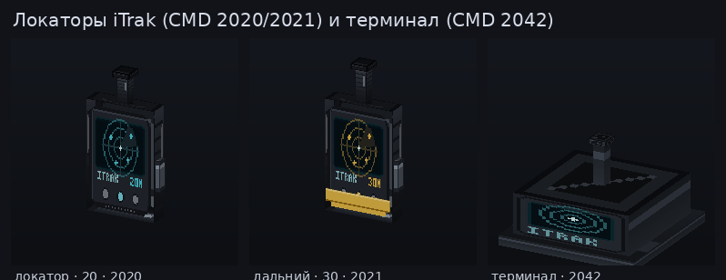
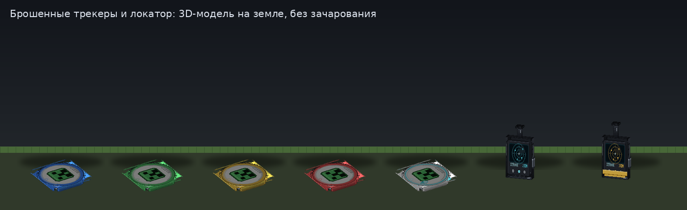

# HahGPS — ресурспак: стрелки, 3D-трекеры и локаторы

Готовый пак для Minecraft **1.21.11 и выше**: `dist/hahgps.zip`.
Он рисует стрелки маршрута «как в жизни», 3D-трекеры iTrak всех цветов
и локаторы. Свои текстуры живут в namespace `hahgps`, ванильные
предметы переопределяются только через `custom_model_data` с откатом.

## Что внутри

| Что | CMD | Формат |
|---|---|---|
| Стрелки в HUD и чате: прямо, влево, вправо, разворот | шрифт `hahgps:arrow`, `\uE000…\uE007` | 8×8, ванильные формы, жёлтые |
| Предмет «знак-указатель» — 3D, чёрная плита на стойке | 1810–1817 (`oak_sign`) | 3D-модель |
| Блок-знак — 3D, плита на бетонной опоре | 1820–1827 (`oak_sign`) | 3D-модель |
| Трекеры iTrak: 8 цветов × обычный/водонепроницаемый | 2001–2016 (8 материалов) | 3D-диск «AirTag» с головой крипера |
| Локатор и дальний локатор | 2020/2021 (`recovery_compass`) | 3D-сканер с экраном-радаром |

Порядок цветов и номера — как в `ru.hahgps.item.ItemIds`:

| Цвет | Обычный | Водонепроницаемый |
|---|---|---|
| blue | 2001 | 2002 |
| cyan | 2003 | 2004 |
| green | 2005 | 2006 |
| yellow | 2007 | 2008 |
| orange | 2009 | 2010 |
| red | 2011 | 2012 |
| purple | 2013 | 2014 |
| white | 2015 | 2016 |

## Установка

1. Положить `hahgps.zip` в `.minecraft/resourcepacks/`.
2. Включить пак в «Настройки → Наборы ресурсов».
3. В игре — `/gps pack` (пак не навязывается при входе).

Пак вложен в jar плагина, но по умолчанию `/gps pack` отправляет **публичный
адрес на нашем сервере** — `https://hahgps.hakerone.ru/hahgps.zip`. Файл лежит
в `/var/www/hahgpspack`, его отдаёт nginx через Cloudflare Tunnel, поэтому пак
качается и за NAT, без проброса портов. Ключ `resource-pack.publish` (каталог
веб-раздачи на машине плагина) заставляет плагин сам обновлять файл. Если нужен
свой сервер, поставьте `resource-pack.url: local`: плагин поднимет HTTP-сервер
на `resource-pack.port` (8123). Любой прямой URL тоже принимается.

Проверка предметов в креативе:

```
/give @s lapis_lazuli[minecraft:custom_model_data={floats:[2001]}]
/give @s recovery_compass[minecraft:custom_model_data={floats:[2021]}]
```

## Что важно

* **Трекеры не зачарованы.** В предмете стоит
  `enchantment_glint_override: false`, поэтому блика нет даже у
  водонепроницаемой версии; она отличается бирюзовым кантом и каплей.
* **Объём на земле.** У моделей прописан `display.ground`, поэтому выброшенный
  трекер лежит на земле объёмным диском, а не плоской иконкой.
* **Ванильные предметы не ломаются.** У `oak_sign` и `recovery_compass`
  добавлен только диспетчер `custom_model_data`; fallback — ванильная модель.
  У `recovery_compass` fallback — полная ванильная модель компаса, поэтому
  стрелка на точку смерти сохраняется.
* **Ванильные блоки не тронуты.** Пак не содержит `blockstates` и
  `textures/block` ванильных блоков; все наши текстуры — `hahgps:item/*`.

## Сборка

```bash
python3 respack/build.py     # нужны pillow и numpy
```

Скрипт рисует текстуры (`arrow_art.py`, `tracker_art.py`), собирает модели и
шрифт, проверяет ссылки, рендерит превью в `preview/` и упаковывает
`dist/hahgps.zip`. Копия кладётся в `src/main/resources/hahgps.zip` — именно её
раздаёт `/gps pack`. Макеты меню для скриншотов — `python3 respack/ui_mockup.py`.

Zip собирается **байт-в-байт воспроизводимо**: дата записей фиксирована, права
`0644`, поэтому одинаковый исходник даёт одинаковый sha1. Это важно — клиент
Minecraft качает пак по публичному адресу, а сверяет его с хэшем из jar; при
разных mtime sha1 расходился и установка падала с «Не удалось загрузить 1 из 1
наборов». Тот же файл кладётся в веб-раздачу `/var/www/hahgpspack/hahgps.zip`
на сервере (nginx + Cloudflare Tunnel); при локальном запуске плагин делает это
сам, если задан `resource-pack.publish`.

## Превью






