# HahGPS — ресурспак: стрелки, иконки меню, 3D-трекеры и локаторы

Готовый пак для Minecraft **1.21.11 и выше**: `dist/hahgps.zip`.
Он рисует жёлтые стрелки маршрута в HUD, иконки меню «как настоящие вещи»
и все предметы iTrak. Свои текстуры живут в namespace `hahgps`, ванильные
предметы переопределяются только через `custom_model_data` с откатом.

## Что внутри

| Что | CMD | Формат |
|---|---|---|
| Стрелки в HUD и чате: прямо, влево, вправо, разворот | шрифт `hahgps:arrow`, `\uE000…\uE007` | 8×8, ванильные формы, жёлтые |
| Навигация: назад, вперёд, инфо, закрыть, страница, бренд, фон | 1001–1007 | 32×32 |
| Главное меню: категории, поиск, настройки | 1102, 1104, 1105 | 32×32 |
| Главное меню: мои точки, каталог, мои трекеры | 1101, 1106, 1107 | 3D: карта с компасом, витрина, брелок |
| Карточка точки: досье, маршрут, оценка, удаление | 1301–1304 | 32×32 |
| Точки: компас, маяк, книга, жемчуг, звезда, записка | 1201–1206 | 32×32 |
| Категории: папка, создать, удалить | 1401–1403 | 32×32 |
| Поиск: ввод, быстрый, результат, пусто, лимит | 1501–1505 | 32×32 |
| Настройки: язык, журнал | 1601–1602 | 32×32 |
| Транспорт: пешком, машина, общественный, авиа, вода | 1701–1705 | 32×32 |
| Карточка трекера и каталог: инфо, маршрут, слежение, забрать, удалить, переименовать, сканировать, выдать, обновить, «пусто» | 2030, 2032–2039, 2044 | 32×32 |
| Трекеры iTrak: 8 цветов × обычный/водонепроницаемый | 2001–2016 (8 материалов) | 3D-диск «AirTag» с головой крипера |
| Локатор и дальний локатор | 2020/2021 (`recovery_compass`) | 3D-сканер с экраном-радаром |

Иконки меню (31 штука) рисуются в `gui_art.py`: объекты реального мира —
папки, лупа, шестерня, глобус, планшет с карандашом, ботинок, машина, поезд,
самолёт, катер, компас и маяк.

Что 3D, а что 2D — сознательное разделение. **Объёмные** иконки у разделов
главного меню (`1101`, `1106`, `1107`) — это «вещи на столе»: складная карта
с компасом и пином, витрина с трекером под стеклом, жетон на стальном
держателе (`ui_models.py`). Их видно в слоте с нескольких сторон, как
трекеры. **Плоские** 32×32 — карточки и кнопки: досье точки, пунктирный
маршрут, звезда оценки, корзина, глаз слежения, радар, каталог, бирка, замок,
каталожная коробка (`ui_art.py`). В слоте важнее мгновенная читаемость значка,
чем объём; поэтому действия в карточках — 2D, а разделы меню — 3D.

Диск трекера в главном меню намеренно крупный: маленький жетон рядом с
картой и витриной терялся.
3D-знаки маршрута (прежние CMD 1810–1827) убраны из плагина и пака: в мире
маршрут показывает только стрелка в BossBar.

Порядок цветов и номера — как в `ru.hahgps.item.ItemIds`:

| Цвет | Обычный | Водонепроницаемый |
|---|---|---|
| blue | 2001 | 2002 |
| cyan | 2003 | 2004 |
| green | 2005 | 2006 |
| yellow | 2007 | 2008 |
| orange | 2009 | 2010 |
| red | 2011 | 2012 |
| purple | 2013 | 2014 |
| white | 2015 | 2016 |

## Установка

1. Положить `hahgps.zip` в `.minecraft/resourcepacks/`.
2. Включить пак в «Настройки → Наборы ресурсов».
3. В игре — `/gps pack` (пак не навязывается при входе).

Пак вложен в jar плагина, но по умолчанию `/gps pack` отправляет **публичный
адрес на нашем сервере** — `https://hahgps.hakerone.ru/hahgps.zip`. Файл лежит
в `/var/www/hahgpspack`, его отдаёт nginx через Cloudflare Tunnel, поэтому пак
качается и за NAT, без проброса портов. Ключ `resource-pack.publish` (каталог
веб-раздачи на машине плагина) заставляет плагин сам обновлять файл. Если нужен
свой сервер, поставьте `resource-pack.url: local`: плагин поднимет HTTP-сервер
на `resource-pack.port` (8123). Любой прямой URL тоже принимается.

Проверка предметов и иконок в креативе:

```
/give @s lapis_lazuli[minecraft:custom_model_data={floats:[2001]}]
/give @s recovery_compass[minecraft:custom_model_data={floats:[2021]}]
/give @s book[minecraft:custom_model_data={floats:[1102]}]
/give @s paper[minecraft:custom_model_data={floats:[1501]}]
```

## Что важно

* **Трекеры не зачарованы.** В предмете стоит
  `enchantment_glint_override: false`, поэтому блика нет даже у
  водонепроницаемой версии; она отличается бирюзовым кантом и каплей.
* **Объём на земле.** У моделей прописан `display.ground`, поэтому выброшенный
  трекер лежит на земле объёмным диском, а не плоской иконкой.
* **Ванильные предметы не ломаются.** У материалов добавлен только диспетчер
  `custom_model_data`, а не сам предмет: `fallback` — ванильная модель. Плюс
  записан порог `1 000 000`, чтобы чужие (не наши) номера на том же материале
  тоже показывали ванильный вид. У `recovery_compass` fallback — полная
  ванильная модель компаса, поэтому стрелка на точку смерти сохраняется.
* **Ванильные блоки не тронуты.** Пак не содержит `blockstates` и
  `textures/block`; все наши текстуры — `hahgps:item/*` и `hahgps:gui/*`.

## Сборка

```bash
python3 respack/build.py     # нужны pillow и numpy
```

Скрипт рисует текстуры (`arrow_art.py`, `gui_art.py`, `ui_art.py`,
`tracker_art.py`), собирает модели (`ui_models.py`), дополняет диспетчеры CMD
(`ui_kit.py`) и шрифт, проверяет ссылки, рендерит превью в
`preview/` и упаковывает `dist/hahgps.zip`. Копия кладётся в
`src/main/resources/hahgps.zip` — именно её раздаёт `/gps pack`. Макеты меню для
скриншотов — `python3 respack/ui_mockup.py`.

Zip собирается **байт-в-байт воспроизводимо**: дата записей фиксирована, права
`0644`, поэтому одинаковый исходник даёт одинаковый sha1. Это важно — клиент
Minecraft качает пак по публичному адресу, а сверяет его с хэшем из jar; при
разных mtime sha1 расходился и установка падала с «Не удалось загрузить 1 из 1
наборов». Тот же файл кладётся в веб-раздачу `/var/www/hahgpspack/hahgps.zip`
на сервере (nginx + Cloudflare Tunnel); при локальном запуске плагин делает это
сам, если задан `resource-pack.publish`.

## Превью


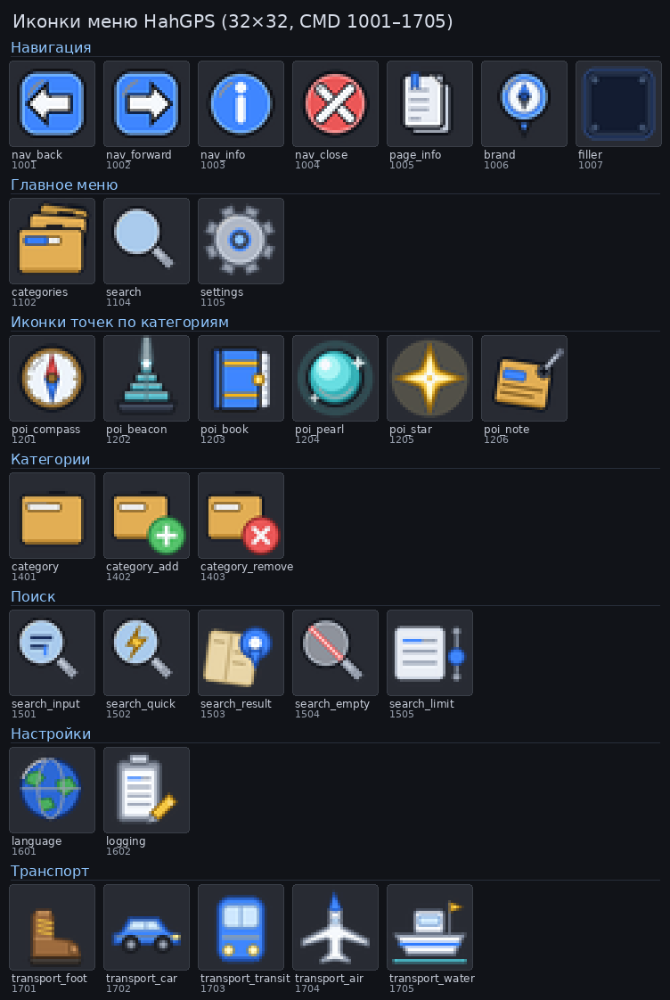
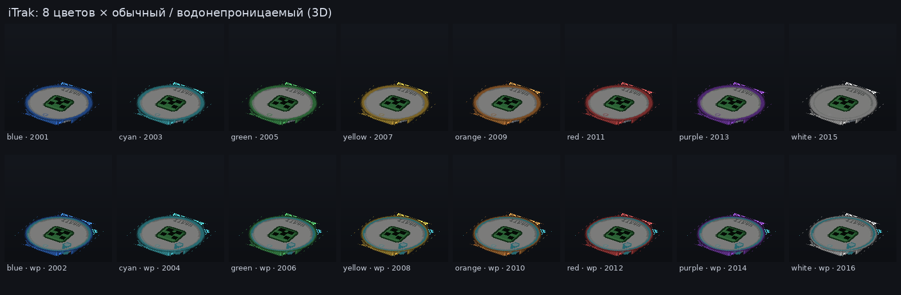
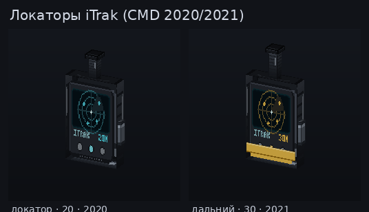
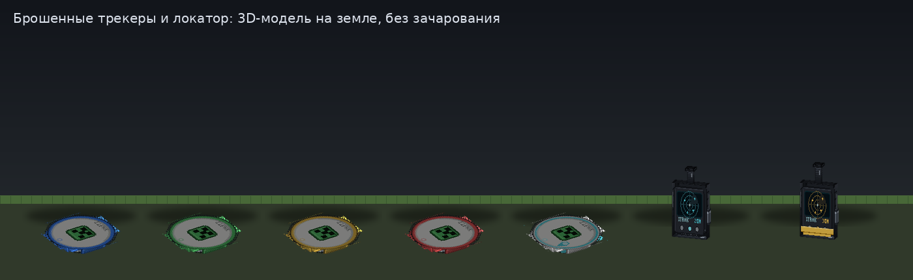
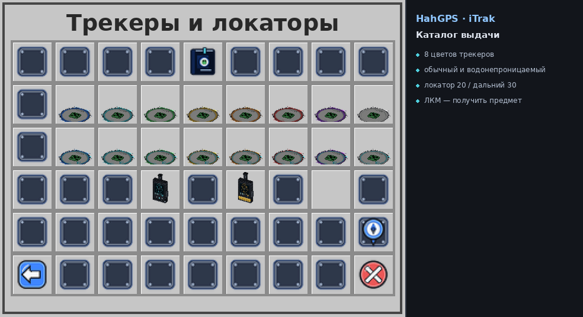
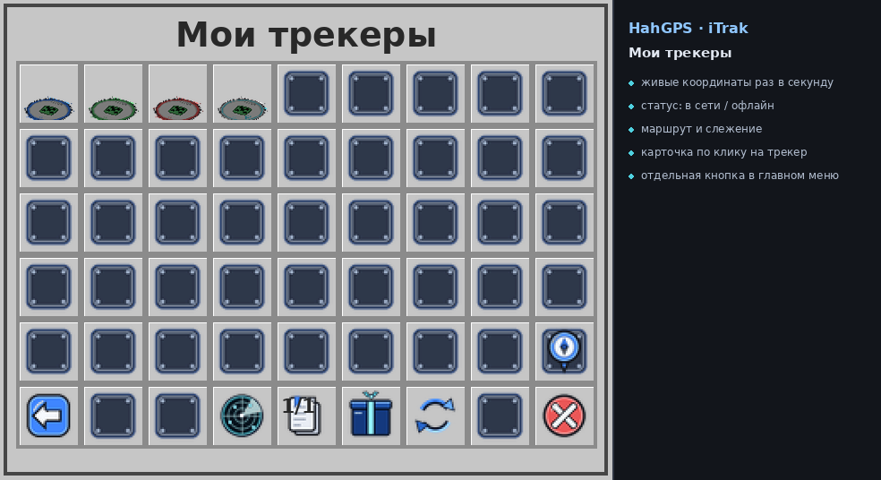
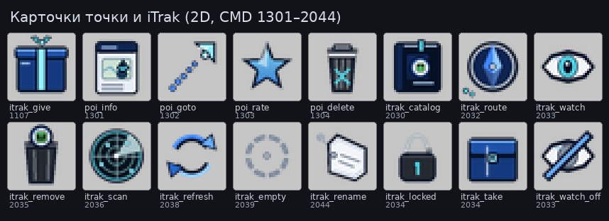
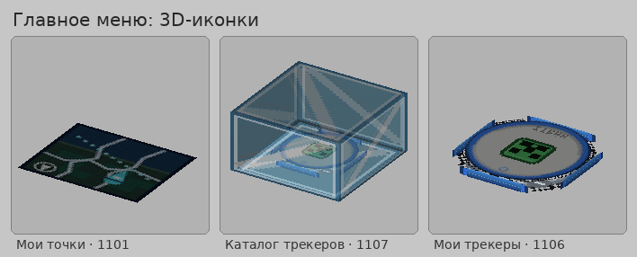
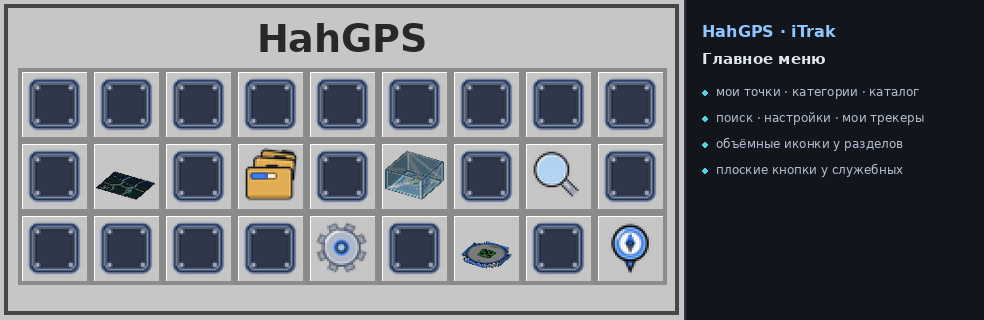
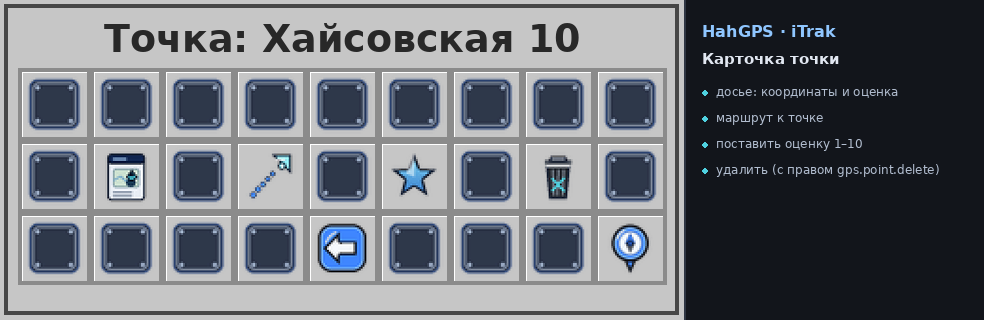
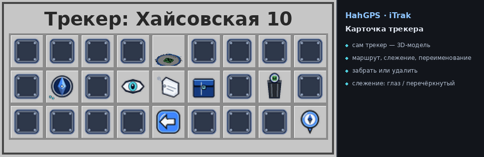
