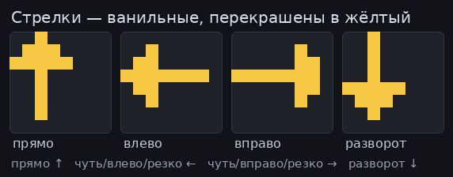
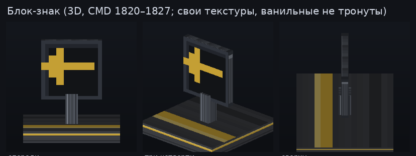

# HahGPS — ресурспак стрелок

Готовый пак для Minecraft **1.21.11 и выше**: `dist/hahgps.zip`.
Он рисует стрелки маршрута «как в жизни» — жёлтый световозвращающий знак на
чёрной плите, — и не переопределяет ванильные блоки: у наших моделей свои
текстуры в namespace `hahgps`.

## Что внутри

| Что | CMD | Формат |
|---|---|---|
| Стрелки в HUD и чате: прямо, влево, вправо, разворот | шрифт `hahgps:arrow`, `\uE000…\uE007` | 8×8, ванильные формы, жёлтые |
| Предмет «знак-указатель» — 3D, чёрная плита на стойке | 1810–1817 (`oak_sign`) | 3D-модель |
| Блок-знак — 3D, плита на бетонной опоре | 1820–1827 (`oak_sign`) | 3D-модель |

Номера совпадают с `ru.hahgps.item.ItemIds.ROUTE_SIGN_BASE` /
`ROUTE_BLOCK_BASE`. Порядок направлений — как в `ru.hahgps.util.RouteArrow`:

| Направление | Глиф | Предмет | Блок |
|---|---|---|---|
| прямо | `\uE000` | 1810 | 1820 |
| чуть левее | `\uE001` | 1811 | 1821 |
| левее | `\uE002` | 1812 | 1822 |
| резко левее | `\uE003` | 1813 | 1823 |
| разворот | `\uE004` | 1814 | 1824 |
| резко правее | `\uE005` | 1815 | 1825 |
| правее | `\uE006` | 1816 | 1826 |
| чуть правее | `\uE007` | 1817 | 1827 |

## Установка

1. Положить `hahgps.zip` в `.minecraft/resourcepacks/`.
2. Включить пак в «Настройки → Наборы ресурсов».
3. В `config.yml` плагина: `navigation.arrow-style: auto` (в свежем конфиге
   так и стоит) — после `/gps pack` клиент загружает пак, и глифы включаются
   сами. `glyphs` — всегда рисованные (без пака будет квадрат), `unicode` —
   всегда ванильные символы.

Пак вложен в jar плагина, но по умолчанию `/gps pack` отправляет **публичный
адрес** файла из репозитория ресурспака — так пак качается и за NAT, без
проброса портов. Если нужен свой сервер, поставьте `resource-pack.url: local`:
плагин поднимет HTTP-сервер на `resource-pack.port` (8123). Любой прямой URL
тоже принимается.

Проверка предметов в креативе:

```
/give @s oak_sign[minecraft:custom_model_data={floats:[1812]}]
```

## Что важно

* **Ванильные блоки не тронуты.** Пак не содержит `blockstates` и
  `textures/block` ванильных блоков; все наши текстуры — `hahgps:block/*` и
  `hahgps:item/*`.
* Переопределён только `assets/minecraft/items/oak_sign.json` — ради
  `custom_model_data`. Для обычного дубового знака (без CMD) стоит
  `fallback` на ванильную модель, поэтому вид ванильных знаков не меняется.
* Настоящий новый блок ресурспаком добавить нельзя: 3D-модель блока лежит в
  паке и выдаётся предметом (CMD 1820–1827), который выглядит как блок.
* Глифы — ванильные пиксельные маски 8×8 из шрифта Minecraft 1.21.11,
  перекрашенные в жёлтый. В ванильном шрифте есть только четыре стрелки
  (←↑→↓), поэтому «чуть/резко влево» показывают ту же ←, а «чуть/резко вправо» — →.

## Сборка

```bash
python3 respack/build.py     # нужны pillow и numpy
```

Скрипт рисует текстуры (`arrow_art.py`), собирает модели и шрифт, проверяет
ссылки, рендерит превью в `preview/` и упаковывает `dist/hahgps.zip`. Копия
кладётся в `src/main/resources/hahgps.zip` — именно её раздаёт `/gps pack`.

## Превью




